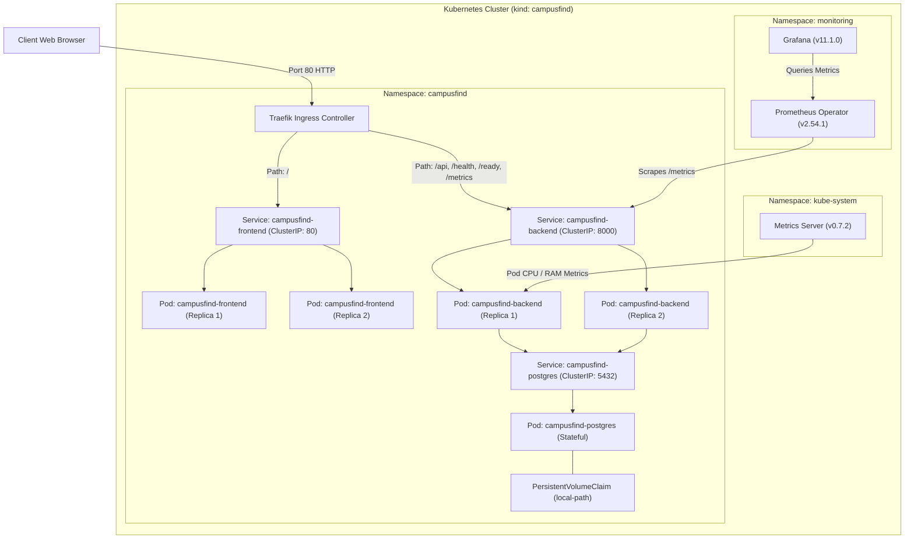

# CampusFind — Campus Lost & Found Tracker

DevOps Final Capstone Project | Session 21

---

## 1. Overview & Problem Statement

**CampusFind** is an enterprise-grade, three-tier Lost and Found tracking system designed specifically for university campuses. On a bustling academic campus, students and staff frequently misplace critical belongings—student ID cards, laptops, headphones, backpacks, keys, and textbooks. Traditional physical lost-and-found desks suffer from fragmented paper logs, delayed notifications, and zero visibility for students searching across multiple campus buildings.

CampusFind resolves this friction by providing a centralized, real-time portal where:
- **Reporters (Students / Staff)** can quickly report lost or found items with location details, item categories, descriptions, and contact info.
- **Finders / Administrators** can track item lifecycles, filter and search through active listings, inspect details, and transition recovered items to a final `CLAIMED` state.
- **Campus Community** gets immediate, transparent visibility into recovered belongings with live statistics and search capabilities.

The project serves as the production vehicle for comprehensive modern DevOps practices: automated testing, containerization, DevSecOps vulnerability scanning, Git commit SHA-driven CI/CD pipelines, Infrastructure as Code (Terraform on AWS), Kubernetes orchestration via Helm, and end-to-end observability (Prometheus & Grafana).

---

## 2. Architecture

CampusFind utilizes a decoupled, cloud-native 3-tier architecture running within a Kubernetes cluster behind a Traefik Ingress Controller.



### Component Breakdown
1. **Frontend Layer**: React 19 single-page application built with Vite and served via an unprivileged Nginx reverse proxy.
2. **Backend API Layer**: FastAPI asynchronous REST API running under Uvicorn with Pydantic validation, SQLAlchemy ORM, and Prometheus instrumentation.
3. **Database Layer**: PostgreSQL 16 database storing relational lost/found items with schema migrations managed via Alembic.
4. **Ingress & Networking**: Traefik Ingress Controller dispatching incoming traffic based on path rules with zero downtime rolling deployments.
5. **Observability Stack**: Prometheus for metric collection and scraping; Grafana for real-time visualization of latency, error rates, and request throughput.

---

## 3. Tech Stack & Pinned Versions

All runtime environments, dependencies, base images, and IaC providers use strictly pinned versions to guarantee reproducible builds across environments.

| Layer | Technology | Pinned Version | Purpose |
|---|---|---|---|
| **Backend Runtime** | Python (Debian Slim) | `3.11-slim` | Lean, secure execution environment |
| **Backend Framework** | FastAPI | `0.115.11` | High-performance async REST API framework |
| **Data Validation** | Pydantic | `2.10.6` | Strict payload schema validation |
| **ORM & Database** | SQLAlchemy / psycopg2 | `2.0.38` / `2.9.10` | Relational database modeling and pooling |
| **Database Engine** | PostgreSQL (Alpine) | `16-alpine` | Lightweight, ACID-compliant relational storage |
| **Schema Migrations** | Alembic | `1.14.1` | Declarative, version-controlled database schema migrations |
| **ASGI Server** | Uvicorn (standard) | `0.34.0` | Production ASGI web server |
| **Metrics Exporter** | Prometheus FastAPI Instrumentator | `7.0.2` | Exposes standard `/metrics` in Prometheus exposition format |
| **Frontend Framework** | React | `19.0.0` | Component-based UI layer |
| **Frontend Tooling** | Vite | `5.4.21` | High-speed frontend build tool & bundler |
| **Web Server (Frontend)**| Nginx (Alpine) | `1.27-alpine` | Non-root web server hosting compiled SPA static assets |
| **Testing** | Pytest / AnyIO | `8.3.4` / `4.15.1` | Isolated unit and integration test suite |
| **Security Scanner** | Aqua Security Trivy | `v0.29.0` | Container image vulnerability and CVE scanner |
| **Orchestration** | Kubernetes (`kind`) | `v1.32.0` | Local container orchestration and cluster runtime |
| **Package Manager** | Helm | `v3.17.1` | Templated Kubernetes application deployments |
| **Ingress Controller** | Traefik | `3.7.14` (`v3.3.4`) | Path-based HTTP ingress routing |
| **Observability** | kube-prometheus-stack | `92.5.0` | Prometheus (`v2.54.1`) & Grafana (`11.1.0`) |
| **Metrics Server** | Kubernetes Metrics Server | `v0.7.2` | Pod resource metric collection for HPA |
| **Infrastructure as Code**| HashiCorp Terraform | `1.14.x` | Declarative cloud infrastructure provisioning |
| **AWS Provider** | `hashicorp/aws` | `~> 5.80` | Official AWS provider plugin |
| **EKS Module** | `terraform-aws-modules/eks` | `~> 20.31` | Battle-tested AWS EKS module |
| **VPC Module** | `terraform-aws-modules/vpc` | `~> 5.0` | Production-ready multi-AZ AWS VPC module |

---

## 4. REST API Reference

The backend exposes a RESTful API with automated Swagger UI documentation available at `http://localhost/docs`.

| Method | Endpoint | Status | Description |
|---|---|---|---|
| `GET` | `/health` | `200 OK` | Liveness probe: returns `{"status": "UP"}` |
| `GET` | `/ready` | `200 OK` | Readiness probe: validates database connectivity with `{"status": "READY"}` |
| `GET` | `/metrics` | `200 OK` | Prometheus exposition endpoint for cluster scraping |
| `GET` | `/` | `200 OK` | Service metadata (`service`, `version`, `docs`) |
| `GET` | `/api/items` | `200 OK` | List items with optional query filters: `status`, `category`, and search term `q` |
| `POST` | `/api/items` | `201 Created` | Create a new lost/found record (validates `title`, `category`, `location`, `reporter_name`) |
| `GET` | `/api/items/{id}` | `200 OK` | Retrieve single item details by ID (returns `404 Not Found` if missing) |
| `PUT` | `/api/items/{id}` | `200 OK` | Update item attributes or status (enforces one-way lifecycle rule) |
| `DELETE`| `/api/items/{id}` | `204 No Content`| Remove an item record by ID |
| `GET` | `/api/items/stats` | `200 OK` | Aggregate statistics: `total`, `lost`, `found`, `claimed`, and breakdown `by_category` |

---

## 5. Local Development (Docker Compose)

The entire application stack can be launched locally with a single command without installing Python, Node.js, or PostgreSQL on the host machine.

### Prerequisites
- Docker Engine 24.x+ and Docker Compose v2.x+

### Quickstart
```bash
# Clone the repository
git clone https://github.com/Kavya100206/campusFind.git
cd campusFind

# Build and start all three services (frontend, backend, postgres)
docker compose up --build
```

### Accessing Local Services
- **Web UI**: [http://localhost:3000](http://localhost:3000)
- **API Backend**: [http://localhost:8000](http://localhost:8000)
- **Interactive API Docs (Swagger)**: [http://localhost:8000/docs](http://localhost:8000/docs)
- **PostgreSQL Database**: `localhost:5432` (`user: campusfind`, `db: campusfind`, `password: campusfind_dev_pw`)

### Clean Teardown
```bash
docker compose down -v
```

---

## 6. Testing & Code Quality

The backend includes a Pytest suite that validates every API endpoint, schema validation edge case, and business logic constraint.

### Key Characteristics
- **No External Database Required**: Uses an in-memory SQLite database via SQLAlchemy (`sqlite:///:memory:`) configured in `backend/tests/conftest.py`.
- **Fast Execution**: All 11 tests execute in under 0.1 seconds.
- **Isolated State**: Database tables are cleanly created and dropped for each test fixture.

### Running Tests Locally
```bash
cd backend
python3 -m venv .venv
source .venv/bin/activate
pip install -r requirements.txt
pytest tests/test_api.py -v
```

**Real Test Output:**
```text
backend/tests/test_api.py::test_health_endpoint PASSED                   [  9%]
backend/tests/test_api.py::test_ready_endpoint PASSED                    [ 18%]
backend/tests/test_api.py::test_root_endpoint PASSED                     [ 27%]
backend/tests/test_api.py::test_create_item_success PASSED               [ 36%]
backend/tests/test_api.py::test_create_item_validation_error PASSED      [ 45%]
backend/tests/test_api.py::test_list_items_and_filters PASSED            [ 54%]
backend/tests/test_api.py::test_get_item_by_id PASSED                    [ 63%]
backend/tests/test_api.py::test_update_item PASSED                       [ 72%]
backend/tests/test_api.py::test_status_transition_claimed_to_lost_rejected PASSED [ 81%]
backend/tests/test_api.py::test_delete_item PASSED                       [ 90%]
backend/tests/test_api.py::test_stats_endpoint PASSED                    [100%]

======================== 11 passed, 1 warning in 0.06s =========================
```

---

## 7. CI/CD Pipeline (GitHub Actions & Trivy)

The continuous integration and continuous deployment workflow is defined in `.github/workflows/ci-cd.yml` and triggers on every push to `main`.

### Workflow Stages

```text
[Push to main]
       │
       ▼
┌────────────────────────────────────────────────────────┐
│ Stage 1: Quality Gate (test-and-lint)                 │
│  - Set up Python 3.11 & Node.js 20                     │
│  - Install backend dependencies                        │
│  - Run pytest with in-memory SQLite (fails on error)  │
│  - Install frontend dependencies & run `vite build`    │
└────────────────────────────────────────────────────────┘
       │
       ▼ (Only runs if Stage 1 succeeds)
┌────────────────────────────────────────────────────────┐
│ Stage 2: Containerization & Security (build-scan-push) │
│  - Log in to GitHub Container Registry (GHCR)          │
│  - Build backend image tagged with commit SHA          │
│  - Build frontend image tagged with commit SHA         │
│  - Scan backend image with Trivy (exit-code: 1)        │
│  - Scan frontend image with Trivy (exit-code: 1)       │
│  - Push immutable SHA-tagged images to GHCR            │
└────────────────────────────────────────────────────────┘
```

### DevSecOps Trivy Security Gate
Both application container images are scanned using Aqua Security Trivy:
- **Severity**: `CRITICAL,HIGH`
- **Exit Code**: `1` (Pipeline halts and prevents image publication if unmitigated critical vulnerabilities exist)
- **Images Published**:
  - `ghcr.io/kavya100206/campusfind-backend:<SHA>`
  - `ghcr.io/kavya100206/campusfind-frontend:<SHA>`
- **No `latest` Tag**: Production images are strictly tagged with the immutable 40-character Git commit SHA (`${{ github.sha }}`) to guarantee traceability and enable safe rollbacks.

---

## 8. Infrastructure as Code (Terraform on AWS)

The infrastructure layer is defined declaratively using HashiCorp Terraform under `terraform/`.

### What It Provisions
- **Region**: `ap-southeast-2` (Sydney)
- **VPC (`campusfind-vpc`)**:
  - CIDR: `10.0.0.0/16`
  - 2 Public Subnets (with Internet Gateway for external routing)
  - 2 Private Subnets (for compute nodes and internal databases)
  - 1 NAT Gateway in the public subnet (enables outbound internet access for private nodes)
  - DNS hostnames and resolution enabled
- **EKS Cluster (`campusfind-eks`)**:
  - Kubernetes Version: `1.31`
  - Managed Node Group: 2x `t3.small` EC2 instances (fits AWS Free Tier vCPU quota limits)
  - IAM Cluster Role & Node Execution Role with minimal least-privilege policies
  - Security Groups restricting inter-service communication

### Operational History & Restricted Account Compatibility
1. **Live Apply & Clean Teardown**: The stack was applied to AWS in `ap-southeast-2` to validate real AWS API provisioning, then cleanly destroyed (`Destroy complete! Resources: 49 destroyed`). Zero billable AWS resources remain active.
2. **Organization SCP Accommodation**:
   During the live apply, the IAM OpenID Connect (OIDC) provider creation was blocked by an AWS Organization Service Control Policy (SCP) enforced on the account. To maintain production standards without breaking restricted accounts:
   - IAM Roles for Service Accounts (IRSA) and the AWS EBS CSI driver were decoupled behind a feature flag: `enable_irsa_ebs_csi` (default: `false` in `variables.tf`).
   - This ensures the committed configuration plans cleanly (`Plan: 50 to add, 0 to change, 0 to destroy`) without requiring administrator SCP overrides.
3. **No Committed Secrets**: Credentials are supplied via environment variables (`AWS_ACCESS_KEY_ID`, `AWS_SECRET_ACCESS_KEY`) or local files. `terraform.tfvars.example` is committed; real `.tfvars` and `.tfstate` files are strictly gitignored.

---

## 9. Kubernetes & Helm (Local kind Cluster)

> **Important Note**: Course Modules M8 (Kubernetes + Helm) and M9 (Observability) were demonstrated and validated on a local `kind` (Kubernetes in Docker) cluster named `campusfind` to eliminate cloud operational costs while maintaining production Kubernetes parity.

### Cluster Setup
The cluster was initialized using `kind-config.yaml` with port mappings forwarding host port `80` to the container control plane:

```bash
# 1. Create kind cluster
kind create cluster --name campusfind --config kind-config.yaml

# 2. Deploy Traefik Ingress Controller
helm repo add traefik https://traefik.github.io/charts
helm repo update
helm upgrade --install traefik traefik/traefik \
  --namespace traefik --create-namespace \
  --set ports.web.nodePort=30080 \
  --set service.type=NodePort

# 3. Deploy Metrics Server
kubectl apply -f https://github.com/kubernetes-sigs/metrics-server/releases/latest/download/components.yaml
kubectl patch deployment metrics-server -n kube-system --type='json' -p='[{"op":"add","path":"/spec/template/spec/containers/0/args/-","value":"--kubelet-insecure-tls"}]'
```

### Deploying CampusFind with Helm
The custom Helm chart is located under `helm/campusfind/`.

```bash
# Deploy or upgrade CampusFind using the latest immutable commit SHA
helm upgrade --install campusfind helm/campusfind \
  --namespace campusfind --create-namespace \
  --set image.tag=f793c275d7ef4aeb067b72c0a587ece7687ac4e1 \
  --set ingress.enabled=true
```

### Verified Pod Health
Listing pods in the `campusfind` namespace shows all services Running with **0 restarts**:

```text
$ kubectl get pods -n campusfind
NAME                                   READY   STATUS    RESTARTS   AGE
campusfind-backend-84cc97dbdf-4fmfb    1/1     Running   0          3m
campusfind-backend-84cc97dbdf-6jsvp    1/1     Running   0          4m
campusfind-frontend-6865d5f79d-67jpw   1/1     Running   0          4m
campusfind-frontend-6865d5f79d-fxt2n   1/1     Running   0          3m
campusfind-postgres-94bd7bbb9-27n4w    1/1     Running   0          30m
```

---

## 10. Observability (Prometheus & Grafana)

The observability stack is deployed via `kube-prometheus-stack` into the `monitoring` namespace.

### Architecture & Metrics Flow
1. **Instrumented Backend**: The FastAPI backend includes `prometheus-fastapi-instrumentator`, exposing:
   - `http_requests_total`: Request volume partitioned by handler, HTTP method, and status code.
   - `http_request_duration_seconds`: High-resolution latency histograms.
2. **Prometheus Scraping**: A Kubernetes `ServiceMonitor` targets the `campusfind-backend` service on port `8000`.
3. **Grafana Dashboards**: Grafana is accessible via port-forwarding:
   ```bash
   kubectl port-forward svc/monitoring-grafana -n monitoring 3000:80
   ```
   Credentials: `admin` / `prom-operator` (or custom secret).

### What Was Disabled on `kind` and Why
When running Prometheus inside a single-node local Docker environment (`kind`):
- **`node-exporter` host filesystem metrics**: Disabled or constrained because containerized Docker engines do not have direct access to root host mount namespaces (`/sys`, `/proc`).
- **`kubelet` / `kube-proxy` internal scrapers**: Disabled components that attempt to scrape loopback endpoints unavailable in kind networking to eliminate noisy error logs and target flapping.

---

## 11. Demo (Rehearsal & Runbook)

This section provides the exact numbered script and measured timings from the live demo rehearsal (M10 requirement, 3 points).

### Live Demo Script

| Step | Action & Command | Purpose | Measured Timing |
|---|---|---|---|
| **1** | Edit `frontend/src/components/Header.jsx` to update the hero tagline to: `"Report, track, and recover lost campus items in real time."` | Introduce small visible UI change | ~10s |
| **2** | Commit change:<br>`git commit -m "feat(ui): update hero banner tagline for demo rehearsal"` | Create immutable commit with descriptive message | ~0.5s |
| **3** | Push to GitHub:<br>`git push origin main` | Trigger automated CI/CD pipeline | **2.1s** |
| **4** | Watch GitHub Actions run to green:<br>URL: `https://github.com/Kavya100206/campusFind/actions/runs/38719935258`<br>- Pytest & Frontend Build: Passed (15s)<br>- Docker Build, Trivy Scan & GHCR Push: Passed (67s) | Validate code quality, zero CVEs, and immutable image publishing | **82s** (~1m 22s) |
| **5** | Upgrade Helm release with new commit SHA:<br>`helm upgrade campusfind helm/campusfind -n campusfind --set image.tag=f793c275d7ef4aeb067b72c0a587ece7687ac4e1 --set ingress.enabled=true` | Trigger rolling upgrade in Kubernetes | **0.45s** |
| **6** | Monitor rollout completion:<br>`kubectl rollout status deployment/campusfind-frontend -n campusfind` | Ensure zero-downtime rolling update | **23.1s** |
| **7** | Verify live at [http://localhost](http://localhost):<br>`curl -s http://localhost/assets/index-Hz0kVEEU.js \| grep -o "Report, track, and recover lost campus items in real time."` | Confirm updated UI tagline is serving live | **< 0.1s** |

**Total Live Deployment Cycle Time**: **~115 seconds** (under 2 minutes from git push to live production rollout with zero downtime and zero restarts).

---

## 12. Troubleshooting Lab

This section documents real-world failure diagnosis and recovery executed in an isolated `troubleshooting-lab` namespace on the local Kubernetes cluster.

### Scenario 1: Pod Stuck in `ImagePullBackOff`

#### 1. Symptom
A newly deployed backend pod fails to start and enters an `ErrImagePull` state, quickly escalating into an exponential back-off cycle (`ImagePullBackOff`).

```text
$ kubectl get pods -n troubleshooting-lab
NAME                                       READY   STATUS             RESTARTS   AGE
campusfind-broken-image-644bbcd496-pjp7n   0/1     ImagePullBackOff   0          25s
```

#### 2. Commands Used
```bash
# Check pod status and restart count
kubectl get pods -n troubleshooting-lab

# Inspect detailed container lifecycle and kubelet event stream
kubectl describe pod -l app=campusfind-broken-image -n troubleshooting-lab

# Verify recent cluster events chronologically
kubectl get events -n troubleshooting-lab --sort-by='.metadata.creationTimestamp'
```

**Real Output (`kubectl describe pod`):**
```text
Containers:
  backend:
    Image:          ghcr.io/kavya100206/campusfind-backend:nonexistent-tag
    State:          Waiting
      Reason:       ErrImagePull
    Ready:          False
...
Events:
  Type     Reason     Age   From               Message
  ----     ------     ----  ----               -------
  Normal   Scheduled  15s   default-scheduler  Successfully assigned troubleshooting-lab/campusfind-broken-image-644bbcd496-pjp7n to campusfind-control-plane
  Normal   Pulling    14s   kubelet            spec.containers{backend}: Pulling image "ghcr.io/kavya100206/campusfind-backend:nonexistent-tag"
  Warning  Failed     13s   kubelet            spec.containers{backend}: Failed to pull image "ghcr.io/kavya100206/campusfind-backend:nonexistent-tag": rpc error: code = NotFound desc = failed to pull and unpack image "ghcr.io/kavya100206/campusfind-backend:nonexistent-tag": failed to resolve reference "ghcr.io/kavya100206/campusfind-backend:nonexistent-tag": ghcr.io/kavya100206/campusfind-backend:nonexistent-tag: not found
  Warning  Failed     13s   kubelet            spec.containers{backend}: Error: ErrImagePull
  Normal   BackOff    13s   kubelet            spec.containers{backend}: Back-off pulling image "ghcr.io/kavya100206/campusfind-backend:nonexistent-tag"
  Warning  Failed     13s   kubelet            spec.containers{backend}: Error: ImagePullBackOff
```

#### 3. Root Cause
The deployment container specification targeted a non-existent tag `ghcr.io/kavya100206/campusfind-backend:nonexistent-tag`. The container runtime (`containerd` via `kubelet`) queried GitHub Packages (GHCR), received an HTTP 404 (`NotFound: not found`), and backed off pulling the image.

#### 4. Fix & Verification
Update the deployment image to the valid, immutable commit SHA published to GHCR:
```bash
kubectl set image deployment/campusfind-broken-image backend=ghcr.io/kavya100206/campusfind-backend:ce0cbedd6efc38f5b528ae12eed42518445201d9 -n troubleshooting-lab
```

**Real Output Verification:**
```text
$ kubectl get pods -n troubleshooting-lab
NAME                                       READY   STATUS    RESTARTS   AGE
campusfind-broken-image-7d7d779745-7xmv4   1/1     Running   0          6s
```

---

### Scenario 2: Service with Missing Endpoints (`<none>`)

#### 1. Symptom
The `campusfind-broken-service` Service exists and is assigned a ClusterIP, but incoming requests fail and return connection timeouts or connection refused. Listing endpoints shows `<none>`.

```text
$ kubectl get endpoints -n troubleshooting-lab
NAME                        ENDPOINTS   AGE
campusfind-broken-service   <none>      31s
```

#### 2. Commands Used
```bash
# Check service configuration and selector
kubectl get svc -n troubleshooting-lab -o wide

# Check endpoints registered to the service
kubectl get endpoints -n troubleshooting-lab

# Describe the service details and events
kubectl describe svc campusfind-broken-service -n troubleshooting-lab

# Inspect actual pod labels in the namespace
kubectl get pods -n troubleshooting-lab --show-labels
```

**Real Output (`kubectl describe svc` & `kubectl get pods --show-labels`):**
```text
$ kubectl describe svc campusfind-broken-service -n troubleshooting-lab
Name:                     campusfind-broken-service
Namespace:                troubleshooting-lab
Selector:                 app=campusfind-wrong-selector
Type:                     ClusterIP
IP:                       10.96.106.17
Port:                     http  8000/TCP
TargetPort:               8000/TCP
Endpoints:                

$ kubectl get pods -n troubleshooting-lab --show-labels
NAME                                       READY   STATUS    RESTARTS   AGE   LABELS
campusfind-backend-test-6d7dd56dfc-ndfxg   1/1     Running   0          5s    app=campusfind-backend,pod-template-hash=6d7dd56dfc
```

#### 3. Root Cause
There is a label selector mismatch. The Service was configured with `spec.selector.app: campusfind-wrong-selector`, while the backend Pod has `metadata.labels.app: campusfind-backend`. Because the selector matched zero pods, the Kubernetes EndpointSlice controller did not attach any target pod IP addresses to the Service.

#### 4. Fix & Verification
Patch the Service's selector to match the target Pod's actual label:
```bash
kubectl patch svc campusfind-broken-service -n troubleshooting-lab -p '{"spec":{"selector":{"app":"campusfind-backend"}}}'
```

**Real Output Verification:**
```text
$ kubectl get endpoints campusfind-broken-service -n troubleshooting-lab
NAME                        ENDPOINTS          AGE
campusfind-broken-service   10.244.0.23:8000   61s

$ kubectl get endpointslices -l kubernetes.io/service-name=campusfind-broken-service -n troubleshooting-lab
NAME                              ADDRESSTYPE   PORTS   ENDPOINTS     AGE
campusfind-broken-service-rkrg5   IPv4          8000    10.244.0.23   70s
```
The Service immediately registered the healthy pod endpoint (`10.244.0.23:8000`), restoring cluster-internal network routing.

---

## 13. Repository Layout

```text
campusFind/
├── .github/
│   └── workflows/
│       └── ci-cd.yml             # GitHub Actions CI/CD pipeline
├── backend/
│   ├── alembic/                  # Database migration versions & env
│   ├── app/                      # FastAPI application code
│   │   ├── config.py             # Settings & environment variables
│   │   ├── db.py                 # Database session engine & Base
│   │   ├── main.py               # API endpoints & routing
│   │   ├── models.py             # SQLAlchemy ORM models
│   │   └── schemas.py            # Pydantic request/response schemas
│   ├── tests/                    # Pytest test suite & conftest.py
│   ├── Dockerfile                # Multi-stage, non-root backend image
│   ├── pytest.ini                # Pytest configuration
│   └── requirements.txt          # Pinned Python dependencies
├── frontend/
│   ├── src/                      # React 19 application components & CSS
│   ├── Dockerfile                # Multi-stage Node build + Nginx runtime
│   ├── nginx.conf                # Non-root unprivileged Nginx configuration
│   ├── package.json              # Pinned npm dependencies
│   └── vite.config.js            # Vite bundler configuration
├── helm/
│   └── campusfind/               # CampusFind application Helm chart
│       ├── Chart.yaml            # Chart metadata & version
│       ├── values.yaml           # Default values & configurations
│       └── templates/            # Deployments, Services, Ingress, ConfigMaps
├── k8s/
│   └── namespace.yaml            # Base Kubernetes namespace manifest
├── kind-config.yaml              # Local kind cluster definition with port 80 mapping
├── monitoring/
│   └── values.yaml               # Values for kube-prometheus-stack
├── terraform/
│   ├── main.tf                   # EKS cluster, node groups & IRSA
│   ├── vpc.tf                    # VPC, subnets, NAT Gateway & routing
│   ├── variables.tf              # Input variables (with enable_irsa_ebs_csi)
│   ├── outputs.tf                # Cluster & VPC outputs
│   └── terraform.tfvars.example  # Example variable definitions
├── troubleshooting/              # Manifests for troubleshooting lab
├── docker-compose.yml            # Local 3-tier development stack
├── .gitignore                    # Secrets, venv, node_modules exclusions
└── README.md                     # Root project documentation
```
