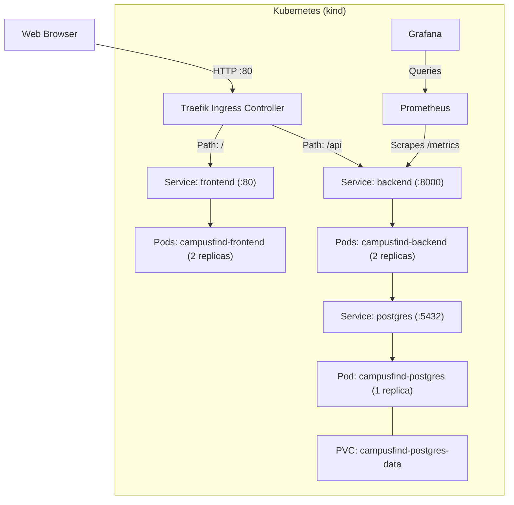

# CampusFind

CampusFind is an application for reporting, searching, and tracking lost and found items across a campus.

## Architecture



## Tech Stack

| Layer | Technology | Version | Purpose |
|---|---|---|---|
| Frontend | React / Vite | 18.3.1 / 5.4.21 | User interface and bundling |
| Frontend Server | Nginx (unprivileged) | 1.27-alpine | Static asset web server |
| Backend Runtime | Python | 3.12-slim | API runtime |
| Backend Framework | FastAPI / Uvicorn | 0.143.0 / 0.34.0 | REST API and ASGI server |
| Database & ORM | PostgreSQL / SQLAlchemy | 16-alpine / 2.0.36 | Relational storage and ORM |
| Migrations | Alembic | 1.14.0 | Database schema migrations |
| Security Scan | Aqua Trivy action | 0.36.0 | Container vulnerability scanner |
| Orchestration | Kubernetes (`kind`) | Server v1.37.0 / kind v0.33.0 | Container orchestration |
| Ingress | Traefik | Chart 41.7.1 (app v3.7.14) | Ingress routing |
| Packaging | Helm | 3.17.1 | Kubernetes package manager |
| Observability | kube-prometheus-stack | 92.5.0 | Prometheus and Grafana stack |
| Infrastructure | Terraform | >= 1.7.0 (AWS provider 5.100.0) | Cloud infrastructure provisioning |

## API

| Method | Path | Purpose |
|---|---|---|
| `GET` | `/health` | Liveness check (`{"status":"UP"}`) |
| `GET` | `/ready` | Readiness check and DB ping (`{"status":"READY"}`) |
| `GET` | `/metrics` | Prometheus metrics export |
| `GET` | `/docs` | OpenAPI documentation |
| `GET` | `/api/items` | List items with filters (`status`, `category`, `q`) |
| `POST` | `/api/items` | Create a lost or found item record |
| `GET` | `/api/items/{id}` | Get item details |
| `PUT` | `/api/items/{id}` | Update item fields or status |
| `DELETE` | `/api/items/{id}` | Delete an item |
| `GET` | `/api/items/stats` | Aggregated counts by status and category |

### Accessing Internal Routes
- **Docker Compose**: Available directly at `http://localhost:8000/docs`, `http://localhost:8000/health`, and `http://localhost:8000/metrics`.
- **Kubernetes (kind)**: Ingress routes `/` to frontend and `/api` to backend (with `/health` proxied via frontend Nginx). To access `/docs`, `/ready`, or `/metrics` directly on the backend, forward the service port:
  ```bash
  kubectl port-forward svc/campusfind-backend -n campusfind 8000:8000
  ```
  Then open `http://localhost:8000/docs` or `http://localhost:8000/metrics`.

## Run Locally

```bash
docker compose up --build
```
- **Frontend**: http://localhost:3000
- **Backend API**: http://localhost:8000
- **API Docs**: http://localhost:8000/docs
- **Database**: `localhost:5432` (credentials in `docker-compose.yml` and `.env.example`: user `campusfind`, password `campusfind`, database `campusfind` — dev only)

Teardown: `docker compose down -v`

## Tests

Tests use an isolated in-memory SQLite database (`sqlite:///:memory:`) configured in `backend/tests/conftest.py`, requiring no running PostgreSQL instance.

```bash
cd backend && pytest -v
```
```text
======================== 11 passed, 1 warning in 0.06s =========================
```

## CI/CD

The workflow in `.github/workflows/ci-cd.yml` runs on pushes and pull requests to `main`:
1. **Test & Build**: Runs pytest on Python 3.12 and builds the frontend with Node.js 22.
2. **Container Build & Scan**: Builds backend and frontend images tagged with the commit SHA (`${{ github.sha }}`).
3. **Security Gate**: Aqua Trivy scans both images, failing on `HIGH` or `CRITICAL` vulnerabilities. The workflow sets `ignore-unfixed: true`, which skips vulnerabilities that have no upstream vendor fix available yet.
4. **Publish**: Pushes immutable SHA-tagged images to GitHub Container Registry (`ghcr.io`). No `latest` tag is used.

## Terraform on AWS

Terraform configuration in `terraform/` provisions:
- **Region**: `ap-southeast-2` (Sydney)
- **VPC**: CIDR `10.20.0.0/16`, 2 public subnets (`10.20.101.0/24`, `10.20.102.0/24`), 2 private subnets (`10.20.1.0/24`, `10.20.2.0/24`) across 2 availability zones, 1 Internet Gateway, and 1 NAT Gateway
- **EKS Cluster**: Cluster `campusfind-eks` (version `1.35`) with a managed node group of 2 `t3.small` nodes in private subnets
- **Feature Flag**: `enable_irsa_ebs_csi` (default `false`) keeps IAM Roles for Service Accounts and EBS CSI optional because an organisation policy blocked IAM OIDC provider creation on the account.

The infrastructure was applied and destroyed afterwards. AWS credentials are supplied via environment variables (`AWS_ACCESS_KEY_ID`, `AWS_SECRET_ACCESS_KEY`) and are never stored in repository files.

```bash
cd terraform
terraform init && terraform plan && terraform apply && terraform destroy
```

## Kubernetes and Helm

The application and monitoring stack were run on a local `kind` cluster to avoid cloud infrastructure costs.

```bash
kind create cluster --name campusfind --config k8s/kind-config.yaml
helm repo add traefik https://traefik.github.io/charts && helm repo update
helm upgrade --install traefik traefik/traefik -n traefik --create-namespace --set ports.web.nodePort=30080 --set service.type=NodePort
kubectl apply -f https://github.com/kubernetes-sigs/metrics-server/releases/latest/download/components.yaml
kubectl patch deployment metrics-server -n kube-system --type='json' -p='[{"op":"add","path":"/spec/template/spec/containers/0/args/-","value":"--kubelet-insecure-tls"}]'
helm upgrade --install campusfind helm/campusfind -n campusfind --create-namespace --set image.tag=f793c275d7ef4aeb067b72c0a587ece7687ac4e1 --set ingress.enabled=true
```

Verified pods:
```text
$ kubectl get pods -n campusfind
NAME                                   READY   STATUS    RESTARTS   AGE
campusfind-backend-84cc97dbdf-4fmfb    1/1     Running   0          12m
campusfind-backend-84cc97dbdf-6jsvp    1/1     Running   0          13m
campusfind-frontend-6865d5f79d-67jpw   1/1     Running   0          13m
campusfind-frontend-6865d5f79d-fxt2n   1/1     Running   0          13m
campusfind-postgres-94bd7bbb9-27n4w    1/1     Running   0          39m
```

## Monitoring

The FastAPI backend exposes Prometheus metrics via `prometheus-fastapi-instrumentator` at `/metrics`, scraped by Prometheus using a `ServiceMonitor`.

- **Dashboard**: `monitoring/campusfind-dashboard.json` (request rate, latency, error rate, item metrics)
- **Helm Values**: `monitoring/prometheus-values.yaml`
- **Access Grafana**: `kubectl port-forward svc/monitoring-grafana -n monitoring 3000:80` (login `admin` / `prom-operator`)

### Disabled on kind
In `monitoring/prometheus-values.yaml`, `alertmanager`, `nodeExporter`, `kubeControllerManager`, `kubeScheduler`, `kubeEtcd`, and `kubeProxy` are disabled. In a single-node local Docker environment, control-plane and host-level scrapers lack direct host namespace access and generate target flapping.

## Demo

1. Edit `frontend/src/components/Header.jsx` to update the hero tagline.
2. Commit: `git commit -m "feat(ui): update hero banner tagline for demo rehearsal"`
3. Push: `git push origin main`
4. Watch CI pipeline finish green: `https://github.com/Kavya100206/campusFind/actions/runs/38719935258`
5. Upgrade Helm release with the new commit SHA:
   ```bash
   helm upgrade campusfind helm/campusfind -n campusfind --set image.tag=f793c275d7ef4aeb067b72c0a587ece7687ac4e1 --set ingress.enabled=true
   ```
6. Monitor rollout: `kubectl rollout status deployment/campusfind-frontend -n campusfind`
7. Verify change at `http://localhost`.

| Step | Action | Measured Timing |
|---|---|---|
| Push | `git push origin main` | 2.1s |
| Pipeline | GitHub Actions run 38719935258 | 82s |
| Helm Upgrade | `helm upgrade campusfind` | 0.45s |
| Rollout | Frontend deployment rollout complete | 23.1s |
| Verification | Tagline live on http://localhost | < 0.1s |

## Troubleshooting

### 1. Pod Stuck in ImagePullBackOff
- **Symptom**: Pod fails to start and enters `ImagePullBackOff` with `ErrImagePull`.
- **Commands used**:
  ```bash
  kubectl get pods -n troubleshooting-lab
  kubectl describe pod -l app=campusfind-broken-image -n troubleshooting-lab
  ```
- **Real output**:
  ```text
  Failed to pull image "ghcr.io/kavya100206/campusfind-backend:nonexistent-tag": rpc error: code = NotFound
  Warning  Failed   kubelet  Error: ImagePullBackOff
  ```
- **Root cause**: Deployment targeted `nonexistent-tag`, returning HTTP 404 from GHCR.
- **Fix**: Update the image tag to a valid published commit SHA:
  ```bash
  kubectl set image deployment/campusfind-broken-image backend=ghcr.io/kavya100206/campusfind-backend:ce0cbedd6efc38f5b528ae12eed42518445201d9 -n troubleshooting-lab
  ```

### 2. Service with No Target Pods (`<none>`)
- **Symptom**: Service has a ClusterIP, but target list shows `<none>` and requests fail.
- **Commands used**:
  ```bash
  kubectl get ep campusfind-broken-service -n troubleshooting-lab
  kubectl describe svc campusfind-broken-service -n troubleshooting-lab
  kubectl get pods -n troubleshooting-lab --show-labels
  ```
- **Real output**:
  ```text
  campusfind-broken-service   <none>   31s
  ```
- **Root cause**: Label selector mismatch between `spec.selector.app: campusfind-wrong-selector` and the pod label `app: campusfind-backend`.
- **Fix**: Patch the service selector to match the pod label:
  ```bash
  kubectl patch svc campusfind-broken-service -n troubleshooting-lab -p '{"spec":{"selector":{"app":"campusfind-backend"}}}'
  ```
  Verified target attached:
  ```text
  campusfind-broken-service   10.244.0.23:8000   61s
  ```

## Repository Layout

```text
campusFind/
├── .github/workflows/ci-cd.yml      # CI/CD pipeline
├── backend/
│   ├── alembic/                     # Database migrations
│   ├── app/                         # FastAPI application code
│   ├── tests/                       # Pytest test suite & conftest.py
│   ├── Dockerfile                   # Python 3.12-slim non-root image
│   ├── pytest.ini                   # Pytest configuration
│   └── requirements.txt             # Pinned backend dependencies
├── frontend/
│   ├── src/                         # React application components
│   ├── Dockerfile                   # Multi-stage Node 22 + Nginx unprivileged
│   ├── nginx.conf                   # Nginx reverse proxy config
│   └── package.json                 # Pinned frontend dependencies
├── helm/campusfind/                 # Application Helm chart
│   ├── templates/                   # Kubernetes manifests
│   └── values.yaml                  # Chart configuration
├── k8s/
│   ├── kind-config.yaml             # kind cluster configuration with port 80 mapping
│   └── namespace.yaml               # Namespace definition
├── monitoring/
│   ├── campusfind-dashboard.json    # Grafana dashboard
│   └── prometheus-values.yaml       # kube-prometheus-stack Helm values
├── scripts/
│   └── load-test.sh                 # HTTP load test script
├── terraform/
│   ├── main.tf                      # EKS cluster, node group, and VPC
│   ├── outputs.tf                   # Terraform output values
│   ├── plan-b-vpc-only.tfvars.example # Example VPC-only variables
│   ├── terraform.tfvars.example     # Example variable values
│   ├── variables.tf                 # Variable declarations
│   └── versions.tf                  # Required versions and provider
├── troubleshooting/                 # Manifests for failure scenarios
├── docker-compose.yml               # Local 3-tier development stack
└── README.md                        # Project documentation
```
